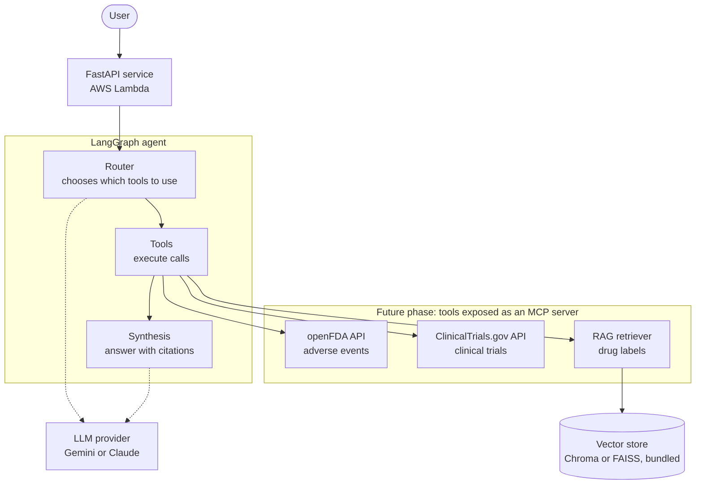

# PharmaGraph

> LangGraph-powered AI agent for pharmacovigilance and clinical research, combining openFDA, ClinicalTrials.gov and RAG over drug labels to answer complex drug-safety questions with cited sources.

**Status:** 🚧 In early development. This README describes the target design; see the [roadmap](#roadmap) for what is built so far.

## Why this project

Answering a question like *"What do we know about the cardiovascular safety of semaglutide, and are there active trials studying it?"* means jumping between several sources: adverse event reports, regulatory labels and clinical trial registries. Each one has a different format and a different API.

PharmaGraph is an agent that does this legwork. You ask a question in natural language, and the agent decides which sources to consult, queries them, and writes an answer in which every claim points back to its source.

## What the agent does

Given a question, the agent:

1. **Plans**: decides which tools are needed (one, several, or none).
2. **Retrieves** from three kinds of sources:
   - **openFDA API**: adverse event reports (FAERS), drug approvals, recalls and labeling.
   - **ClinicalTrials.gov API**: active, recruiting and completed trials.
   - **RAG over drug labels**: semantic search over long, unstructured label text (contraindications, warnings, interactions).
3. **Synthesizes** a grounded answer and cites the source of each statement.

Example questions it is designed to handle:

- *"Which adverse events have been reported for drug X in the last two years?"*
- *"Does the label for drug X mention interactions with anticoagulants, and are there reports of problems?"*
- *"Are there recruiting trials investigating drug X for condition Y?"*

### Why RAG, and where it fits

The two APIs return structured data (counts, dates, statuses), so plain API calls with filters are enough. RAG is used only where APIs cannot help: long documents such as drug labels. Chunks are split by label section and carry metadata (drug, section, source), so retrieval can be filtered by drug *before* the semantic search. Retrieving text about the wrong medication is not an acceptable failure mode in this domain.

The index covers a small, curated set of drugs rather than the whole catalog. This keeps the project cheap to run and makes retrieval quality easy to evaluate.

## Architecture

**How a question flows:** the user calls the FastAPI service, which hands the question to the LangGraph agent. The router picks the tools, the tools query the data sources, and the synthesis step produces the final answer with citations. Router and synthesis rely on an LLM, which is a configurable provider (dotted lines). The vector store is built once, ahead of time, by chunking and embedding the drug labels.

**Design note:** the tools are deliberately kept self-contained. In a later phase they can be extracted into an [MCP](https://modelcontextprotocol.io) server, so the agent consumes them through a standard protocol and other MCP clients can reuse them.

## Design principles

PharmaGraph is built to run on a zero budget, and that shapes several decisions:

- **Local-first.** Everything runs on a laptop during development, with no cloud account required.
- **Provider-agnostic LLM.** The model is a configuration setting, not a hard dependency, so the agent can run on a free-tier model during development and switch to another provider without code changes.
- **Serverless deployment.** The target is AWS Lambda, which fits within the always-free limits at demo-level traffic, instead of always-on services that bill continuously.
- **Embedded vector store.** A small Chroma or FAISS index packaged with the application replaces a managed database.

## Tech stack

- **Agent orchestration:** LangGraph and LangChain
- **API:** FastAPI
- **Data sources:** openFDA, ClinicalTrials.gov
- **Retrieval:** embeddings + Chroma or FAISS
- **LLM:** configurable provider (Gemini, Claude)
- **Deployment:** AWS Lambda

## Roadmap

- [ ] Tools for openFDA and ClinicalTrials.gov, tested in isolation
- [ ] LangGraph agent: routing, tool orchestration and answer synthesis
- [ ] Provider-agnostic LLM configuration
- [ ] FastAPI backend exposing the agent
- [ ] RAG over drug labels as a third tool
- [ ] Evaluation set: questions with known answers to measure retrieval and answer quality
- [ ] Deployment on AWS Lambda
- [ ] Refactor the tools into an MCP server

## Data sources and disclaimer

This project uses publicly available data from [openFDA](https://open.fda.gov/) and [ClinicalTrials.gov](https://clinicaltrials.gov/).

**This is a technical portfolio project, not a medical tool.** Adverse event reports (such as those in FAERS) are spontaneous and unverified: they do not establish that a drug caused an event, and they must not be used to make clinical decisions.

## Getting started

Setup instructions will be added as the first components land.

## License

To be decided.
